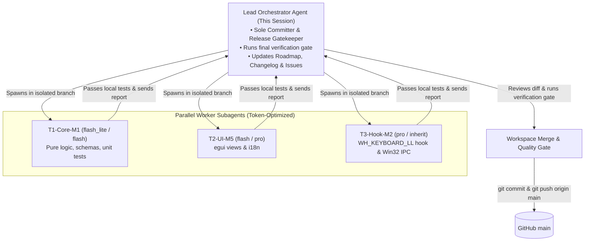

# AGENTS.md — Mandatory Operating Guidelines for AI Agents

> **CRITICAL FOR ALL AI AGENTS & CODING ASSISTANTS:**
> You are working on **MagicBridge** (`https://github.com/DooperDrew/MagicBridge`).
> These guidelines are **strictly binding**. Every agent operating in this repository MUST comply with the workflow, architecture, performance budgets, sole committer protocol, and logging rules defined below without exception.

---

## 1. Project Mission & Identity
- **Name:** MagicBridge
- **Purpose:** A native, ultra-lightweight Windows 10/11 x64 utility that makes the Apple Magic Keyboard with Numeric Keypad (**model A1843**) behave as a first-class Windows keyboard.
- **Key Capabilities:** User-mode Fn layer, media keys vs. F-keys switching, modifier presets, missing system keys (`Print Screen`, `Scroll Lock`, `Pause`), direct HID battery reporting, and named profiles with multiple language layouts (`ISO Italian`, `ANSI US`, `ISO UK`, `ISO German`, `ISO French`, custom).

---

## 2. Multi-Agent Organization & Sole Committer Protocol

To enable clean parallelization across multiple tasks and optimize token consumption across different AI models, MagicBridge enforces a **Hub-and-Spoke (Lead & Worker)** hierarchy:



### Roles & Responsibilities:
1. **The Lead Orchestrator Agent (Sole Committer):**
   - The **ONLY** entity authorized to run `git commit`, `git push`, edit git remotes, modify `origin main`, or close GitHub Issues.
   - Responsible for launching workers, assigning complexity tiers, merging worker branches, running the final quality gate, and updating project documentation.
2. **Worker Agents (`magicbridge-worker`):**
   - Work strictly in isolated branches (`Workspace: "branch"`).
   - **STRICTLY PROHIBITED** from running `git commit`, `git push`, `git checkout main`, or `gh issue close`.
   - Write code, run local verification commands, and return a structured completion report to the Lead.

### Worker Naming Taxonomy
Every subagent role follows the standard convention: `<Tier>-<Domain>-<Milestone>`
- Examples: `T1-Core-M1` (Core config schema), `T3-Hook-M2` (Input hook engine), `T2-UI-M5` (Settings GUI).
- Branch format: `task/<milestone-id>-<short-description>` (e.g. `task/m1.2-config-schema`).

---

## 3. Dynamic Model Selection & Complexity Tiers

To maximize token efficiency without sacrificing code quality or safety, every task is assigned a complexity tier:

| Tier | Scope & Workload | Criteria in MagicBridge | Target Model |
|---|---|---|---|
| **Tier 1 (T1 — Lean)** | Pure logic, schemas, serialization, unit tests, i18n, packaging scripts, docs. | • Pure Rust (`crates/core`).<br>• `#![forbid(unsafe_code)]`.<br>• Zero Win32 dependencies. | **`flash_lite`** or **`flash`** |
| **Tier 2 (T2 — Moderate)** | UI widgets, event handling, named pipes, standard Win32 message pumps. | • `egui` views & layout widgets.<br>• Tray menu callbacks.<br>• Named pipe client/server. | **`flash`** or **`pro`** |
| **Tier 3 (T3 — Complex / Critical)** | Low-level input hooks, atomic memory swaps, raw HID battery reporting, multi-threaded timing synchronization. | • `WH_KEYBOARD_LL` hook callback.<br>• Performance budget compliance (<0.1ms latency, zero alloc/locks).<br>• Hardware timing quirks (`sc=0x21D`). | **`pro`** or **`inherit`** (Opus / Sonnet) |

### Fallback & Retrospective Audit Rule
If a target model is unavailable (due to token limits, quota exhaustion, or rate limits):
1. **Fallback Selection:** Fall back to the next available model in order: `inherit` &rarr; `pro` &rarr; `flash` &rarr; `flash_lite`.
2. **Mandatory Logging:** The Lead Agent MUST immediately log the occurrence in [`docs/model-fallback-log.md`](docs/model-fallback-log.md) recording the task, target model, fallback model used, and reason.
3. **Audit Task Scheduling:** The Lead Agent MUST schedule a retrospective verification task in `docs/05-roadmap.md` under Milestone 6 (Hardening & Performance) to review the fallback implementation with a higher-tier model when tokens/quota permit.

---

## 4. Mandatory Reading Order (Before Any Implementation)
Before writing or modifying any code, the agent MUST read:
1. `docs/01-vision.md`: Core problem, guiding principles, non-goals.
2. `docs/02-requirements.md`: Exact requirements (e.g. F1.1, F7.7, NFR-P1…P5).
3. `docs/03-architecture.md`: Two-process model, crates, IPC, event lifecycle.
4. `docs/hardware-findings.md`: **Hardware ground truth** from physical A1843 testing. (Do NOT assume or guess HID/hardware behavior).
5. `docs/04-ux.md`: System tray specifications and `egui` visual keyboard design.
6. `docs/05-roadmap.md`: The single source of truth for current tasks.
7. `CHANGELOG.md`: Chronological log of decisions, findings, and completed milestones.

---

## 5. Strict Development Workflow & Life of a Task

### A. Pre-Execution Phase
1. **Locate the Task:** Check `docs/05-roadmap.md` for the next unchecked item or work on the specific task assigned by the user.
2. **Restate Intent:** Clearly restate the task, its complexity tier (`T1`/`T2`/`T3`), target crate/files, and acceptance criteria.
3. **Verify Clean Workspace:** Check `git status` and ensure latest changes from `origin main`.

### B. Implementation & Performance Guards
- **Hook Thread Rule (NFR-P3):** The `WH_KEYBOARD_LL` callback in `magicbridge-agent` MUST NEVER allocate memory (`Vec`, `String`, `Box`), perform disk/file I/O, output log prints, acquire locks, or invoke blocking syscalls. Precomputed lookup tables only.
- **Event-Driven Only (NFR-P2):** Zero busy loops or polling timers. All reactions must stem from Win32 message queues, device arrival notifications, or named pipes (except low-frequency battery polling).
- **Anti-Cheat & Driver Rule (NFR-S1):** Strictly **no kernel drivers**, no `.sys` binaries, and **no DLL injection**.
- **Loop Prevention:** Every synthetic input sent via `SendInput` MUST include the distinct `dwExtraInfo` marker (`MAGICBRIDGE_EXTRA_INFO`) and the hook must ignore it.
- **Stuck-Key Resilience (NFR-S3):** Synthetic keys must never remain stuck down if the daemon is closed, suspended, or encounters an error.

### C. Code Conventions & Quality Checks
- **Crate Separation:**
  - `crates/core` (`magicbridge-core`): Pure business logic. `#![forbid(unsafe_code)]`. Zero Win32 dependencies. 100% unit tested.
  - `crates/agent` (`magicbridge-agent`): Daemon, hooks, tray, HID, IPC server.
  - `crates/settings` (`magicbridge-settings`): `egui` GUI, only resident while open.
- **Safety Documentation:** Every `unsafe` block in Win32 wrappers MUST be accompanied by a clear `// SAFETY:` explanatory comment detailing preconditions and invariants.
- **No Hardcoded UI Strings:** All user-facing text belongs in translation files (`locales/en.toml`, `locales/it.toml`).

### D. Verification Gate (MUST PASS Locally)
Before finishing any turn or committing, the Lead Agent MUST run and verify clean output:
```powershell
# 1. Format verification
cargo fmt --all -- --check

# 2. Strict linter (warnings are treated as errors)
cargo clippy --workspace --all-targets -- -D warnings

# 3. Full test suite
cargo test --workspace

# 4. Release compilation check
cargo build --workspace --release
```

### E. Post-Execution & Documentation Synchronization (Lead Agent Only)
Once the task is validated:
1. **Update Roadmap:** Tick the completed box `[x]` in `docs/05-roadmap.md` with commit/date notes.
2. **Log to CHANGELOG.md:** Add a comprehensive entry to `CHANGELOG.md` detailing changes, architectural decisions, and hardware discoveries.
3. **Update Docs:** Update `docs/` or ADRs if architectural decisions changed.
4. **Git Commit & Push:** Commit with an informative message (e.g. `M2.3: modifier presets and per-key remap`) and push to `origin main`.
5. **Update GitHub Issue / Milestone:** Update or close the corresponding GitHub Issue using `gh issue close <id>` or `gh issue edit`.

---

## 6. Hardware Realities & Known Quirks (From M0)
- **Vendor IDs:** The keyboard identifies with `VID = 0x05AC` on USB and **`VID = 0x004C`** over Bluetooth Classic. Always check both via `magicbridge_core::is_apple_vendor`.
- **Physical Fn / Eject:** Stripped by Windows `kbdhid.sys` in kernel mode. MagicBridge relies on user-configurable trigger keys (default: Right Option / `VK_RMENU`).
- **ISO / Italian AltGr Quirk:** Pressing physical Right Option on ISO Italian layouts causes Windows to synthesize an artificial `VK_LCONTROL` with `scanCode == 0x21D` ~0.8 ms earlier. The remapping hook must swallow `0x21D` whenever Right Option is remapped or used as Fn.
- **Battery Report:** Read from Apple Vendor Collection `0xFF00:0x0014` report ID `0x90` (`[0x90, status_flags, pct]`).

---

## 7. Escalation Rule
If physical keyboard behavior or testing contradicts existing documentation:
**STOP immediately. Do not guess or silently hack around it.**
Present the empirical findings to the user, formulate a probe or verification step, and update `docs/hardware-findings.md` upon user alignment.
