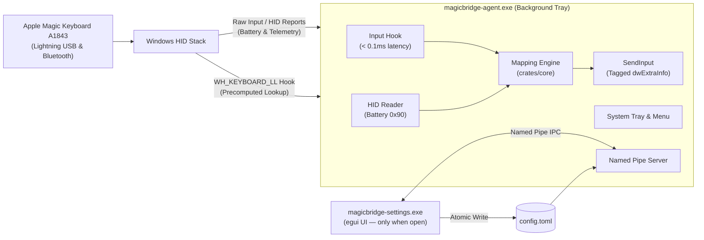

<div align="center">

# MagicBridge ⌨️ 🌉

**A tiny, invisible, native Windows 10/11 utility that makes the Apple Magic Keyboard with Numeric Keypad (A1843) feel right at home on Windows.**

[](https://github.com/DooperDrew/magicbridge/releases/latest)
[](https://www.rust-lang.org/)
[](LICENSE)
[](https://microsoft.com/windows)
[](#performance--safety-budgets)
[-success.svg)](#core-philosophy)

<br/>

| 📖 [User Guide](docs/user-guide.md) | 🪄 [Setup Wizard](scripts/setup-wizard.ps1) | 🧪 [Hardware QA](docs/06-qa-and-validation.md) | 📦 [WinGet & Releases](docs/release-methodology.md) | 🤝 [Community Plan](docs/08-community-and-growth-strategy.md) | 🤖 [Architecture](docs/multi-agent-methodology.md) |
|:---:|:---:|:---:|:---:|:---:|:---:|

</div>

---

## The Problem

The Apple Magic Keyboard with Numeric Keypad (**model A1843**) is a gorgeous piece of hardware, but when paired with Windows 10 or 11 over Bluetooth or Lightning-to-USB:
- **Missing or locked Fn key:** Windows' inbox `kbdhid.sys` locks the main keyboard collection exclusively, leaving the Fn layer inaccessible.
- **Modifier chaos:** `Cmd` and `Option` sit physically where Windows users expect `Alt` and `Windows`.
- **Dumb top row:** F1–F12 media keys (volume, play/pause, rewind) don't behave reliably or switchable with standard function keys.
- **Missing standard keys:** No `Print Screen`, `Scroll Lock`, `Pause`, or dedicated `Insert`. `F13`–`F19` and `Clear` are recognized but idle.
- **No battery indicator:** Windows does not surface battery percentage on the taskbar or tray.
- **Heavy or invasive workarounds:** Existing third-party solutions often require paid licenses, obsolete Apple Boot Camp drivers, kernel-mode filters (which trigger game anti-cheat bans), or bulky Electron apps.

**MagicBridge solves this with zero kernel drivers, zero DLL injection, and zero background idle CPU.**

---

## Core Philosophy

1. **Invisible & Lightweight (0% Idle CPU):** Purely event-driven Win32 messaging and hooks. No polling loops. Working set memory target is under 5 MB.
2. **Anti-Cheat Safe:** No kernel-mode driver (`.sys`), no driver signing issues, no DLL injection. Mappings run purely in user mode, with an instant global toggle to pause whenever you game.
3. **Resilient Hardware Lifecycle:** Gracefully handles sleep/resume, Bluetooth reconnects, and seamless switching between Lightning USB cable and Bluetooth Classic.
4. **Instant & Independent GUI:** Settings app (`magicbridge-settings`) is built with `egui` and only runs when opened. When closed, it takes zero memory.
5. **Privacy First:** 100% offline. No analytics, no telemetry, no network calls.

---

## Key Features

- **Customizable Fn Layer:** Use a comfortable modifier (default: Right Option / `VK_RMENU`) to access intuitive combinations:
  - `Fn + ← / →` &rarr; `Home / End`
  - `Fn + ↑ / ↓` &rarr; `Page Up / Page Down`
  - `Fn + Backspace` &rarr; `Forward Delete (⌦)`
  - `Fn + Enter` &rarr; `Insert`
  - `Fn + F1…F12` &rarr; Alternate media / function layer
- **Top Row Mode Switcher:** Toggle between **Media Keys first** and **Standard F-keys first** directly from the system tray menu or with a global hotkey.
- **One-Click Modifier Presets:** Instantly switch between **Windows Layout** (`Cmd` &rarr; `Alt`, `Option` &rarr; `Win`) and **Mac Layout** (native mapping), or customize modifier positions independently.
- **ISO / Italian Layout AltGr-Safe:** Automatically catches and suppresses the synthetic `LCtrl` (`scancode 0x21D`) generated by Windows when `AltGr` is remapped.
- **Missing Windows Keys:** Out-of-the-box defaults mapping `F13` &rarr; `Print Screen`, `F14` &rarr; `Scroll Lock`, and `F15` &rarr; `Pause`.
- **Custom Key & Macro Actions:** Map `F13`–`F19` and `Clear` (`VK_NUMLOCK`) to custom key combos, media actions, or program launches.
- **Accurate Battery Reporting:** Reads direct battery telemetry from Apple Vendor collection `0xFF00:0x0014` report `0x90` over both USB and Bluetooth, with live tray tooltip percentages and low-battery toast alerts.
- **Named Profiles & Multi-Language Layouts:** Create and swap between named profiles with visual layout previews for `ANSI (US)`, `ISO (Italian)`, `ISO (UK)`, `ISO (German)`, `ISO (French)`, and custom layouts.

---

## Architecture Overview

MagicBridge is engineered as a clean Rust Cargo workspace separating pure business logic from operating system hooks and UI:



### Workspace Structure

| Crate | Package Name | Responsibility |
|---|---|---|
| [`crates/core`](crates/core) | `magicbridge-core` | Pure business logic, key models, layout compilation, config schema. `#![forbid(unsafe_code)]`, zero Win32 dependencies, 100% unit tested. |
| [`crates/agent`](crates/agent) | `magicbridge-agent` | Minimal background daemon: low-level keyboard hook, HID battery reader, tray icon, IPC server, autostart. |
| [`crates/settings`](crates/settings) | `magicbridge-settings` | Fast, lightweight UI built with `eframe`/`egui`. Interactive visual keyboard, profile manager, and i18n support. |
| [`crates/hid-probe`](crates/hid-probe) | `hid-probe` | Milestone 0 diagnostic utility for inspecting HID descriptors, timing Raw Input vs. hooks, and probing Apple battery reports. |

---

## Performance & Safety Budgets

Every release is tested against strict non-functional constraints:

| Metric | Target | Design Guarantee |
|---|---|---|
| **Idle CPU** | **0.0%** | Fully event-driven Win32 event pump. No polling loops. |
| **Agent Memory** | **≤ 5 MB** | Zero unnecessary runtime dependencies or heavyweight frameworks. |
| **Hook Latency** | **< 0.1 ms** | Hook runs precomputed array lookups. No memory allocations, disk I/O, or thread locks on the hook thread. |
| **Game & Anti-Cheat Safety** | **100% Safe** | No kernel driver (`.sys`) and no DLL injection into other processes. Pause hotkey available. |
| **Settings Footprint** | **0 MB (idle)** | Settings window is an independent executable that terminates completely upon close. |

---

## Building & Running

### Prerequisites

- **OS:** Windows 10 or 11 (64-bit)
- **Rust:** Stable toolchain (`x86_64-pc-windows-msvc`) via [rustup](https://rustup.rs/)
- **Build Tools:** Visual Studio C++ Build Tools (MSVC linker)

### Developer Commands

Run from the repository root:

```powershell
# Check workspace formatting
cargo fmt --all -- --check

# Run linter
cargo clippy --workspace --all-targets -- -D warnings

# Execute test suite
cargo test --workspace

# Build optimized release binaries
cargo build --workspace --release

# Run the agent in debug mode (console enabled)
cargo run -p magicbridge-agent

# Run the settings GUI
cargo run -p magicbridge-settings

# Package portable release archive (.zip)
.\scripts\package-release.ps1
```

Compiled binaries will be located in `target/release/` (`magicbridge-agent.exe` and `magicbridge-settings.exe`).

---

## Roadmap & Milestones

Progress is tracked via GitHub Milestones and Issues:

- [x] **[M0: Hardware Spike 🔬](https://github.com/DooperDrew/magicbridge/issues/1)** — Verified USB/BT descriptors, battery report `0x90`, timing benchmarks, and the `AltGr` scancode `0x21D` quirk. See [docs/hardware-findings.md](docs/hardware-findings.md).
- [x] **[M1: Agent Skeleton](https://github.com/DooperDrew/magicbridge/issues/2)** — Single-instance tray app, config schema, autostart, and device lifecycle handling.
- [x] **[M2: Remapping Engine](https://github.com/DooperDrew/magicbridge/issues/3)** — Zero-allocation `WH_KEYBOARD_LL` hook, atomic table swapping, modifier presets, and self-injection prevention.
- [x] **[M3: Fn Layer & Top Row](https://github.com/DooperDrew/magicbridge/issues/4)** — Configurable Fn trigger key, Fn combos, and Media vs. F-keys toggle.
- [x] **[M4: Custom Actions & Battery](https://github.com/DooperDrew/magicbridge/issues/5)** — Off-thread macro execution and background battery monitoring.
- [x] **[M5: Settings GUI](https://github.com/DooperDrew/magicbridge/issues/8)** — Visual A1843 layout editor, multi-language presets, and profile manager.
- [x] **[M6: Hardening & Performance](https://github.com/DooperDrew/magicbridge/issues/6)** — Soak testing, sleep/resume validation, and strict latency measurement.
- [x] **[M7: Packaging & Release](https://github.com/DooperDrew/magicbridge/issues/7)** — Standalone portable zip and installer.
- [x] **[M8: Multi-Agent Methodology & Architecture](https://github.com/DooperDrew/magicbridge/issues/9)** — Didactic multi-agent parallelization documentation, Settings architecture tab, and GitHub Release v0.1.0 parity. See [docs/multi-agent-methodology.md](docs/multi-agent-methodology.md).
- [ ] **M9: Quality Assurance & Empirical Validation** — Physical A1843 hardware matrix execution, sleep/resume, game mode auto-pause, and security verification. See [docs/06-qa-and-validation.md](docs/06-qa-and-validation.md).
- [ ] **M10: User Experience & Onboarding Improvements** — Guided installer wizard, first-run onboarding configuration wizard, responsive Settings layout, and live battery tray indicator. See [docs/07-ux-and-improvements.md](docs/07-ux-and-improvements.md).

---

## Contributing

We welcome community feedback, bug reports, and pull requests! Please check out [CONTRIBUTING.md](CONTRIBUTING.md) for code conventions, safety requirements, and testing guidelines.

## License

This project is licensed under the [MIT License](LICENSE).
