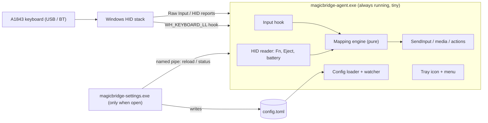

# 03 — Architecture

> Status: **DRAFT**. Items marked 🔬 must be confirmed by the Milestone 0 hardware spike.

## Tech stack (decided — see [decisions/0001-rust.md](decisions/0001-rust.md))

| Concern | Choice |
|---|---|
| Language | **Rust** (stable, `x86_64-pc-windows-msvc`) |
| Win32 API | `windows` crate (official Microsoft bindings) |
| Settings GUI | `egui` / `eframe` (single native exe, only runs while open) |
| Config format | TOML (`serde` + `toml`) in `%APPDATA%\MagicBridge\config.toml` |
| i18n | Simple key→string TOML files per language (`en.toml`, `it.toml`) |
| Build | Cargo workspace; release profile with `lto = true`, `opt-level = "z"` or `3`, `panic = "abort"`, `strip = true` |

## Process model

Two executables, so the heavy GUI never sits in memory:



### Crates (Cargo workspace)
```
crates/
├── core/       # Pure logic: key model, mapping engine, config schema. No Win32. Unit-tested.
├── agent/      # Background exe: hook, HID, tray, IPC server, autostart.
├── settings/   # GUI exe: egui app, visual keyboard, i18n.
└── hid-probe/  # Milestone 0 diagnostic CLI: dumps raw HID reports from the keyboard.
```

## Key technical design

### Input interception
- **`WH_KEYBOARD_LL`** low-level hook for remapping. It's user-mode with no injection, and it's what most
  remappers use. The hook callback has to be **minimal**: look up a precomputed table, then either pass
  the key through or swallow it and queue output. **No allocation, no I/O, no locks** inside the callback
  (NFR-P3). Windows removes hooks that are too slow, so this matters for correctness too.
- Output is sent with `SendInput`. Injected events are tagged (`dwExtraInfo` marker) so the hook
  ignores its own output and can't loop.
- Media actions use the standard virtual keys (`VK_VOLUME_UP`, `VK_MEDIA_PLAY_PAUSE`, …).
- Custom actions (launching programs, etc.) are handed off to a worker thread, never run in the hook.

### Apple-specific keys (Fn, Eject, battery) 🔬
- Fn and Eject are likely reported in a **vendor-specific HID collection** (Apple VID `0x05AC`)
  rather than as normal keys. The agent reads them through **Raw Input** (`RIDEV_INPUTSINK`) or
  `HidD_*`/`ReadFile` on that collection, and keeps a shared atomic `fn_down` flag that the hook reads.
- The exact report IDs, byte offsets, and whether this works the same on **USB and Bluetooth** are
  **unknown until Milestone 0**. The results go into `docs/hardware-findings.md`.
- Battery: read from a HID feature/input report or a Bluetooth device property, whichever the spike
  shows works. Polled every N minutes (F6.3).
- **Fallback:** if Fn can't be read, a user-chosen key acts as Fn (F1.4).

### Device filtering 🔬
- `WH_KEYBOARD_LL` doesn't say which keyboard an event came from. v1 approach:
  - **Default:** assume the Apple keyboard is the main keyboard. Mappings apply globally while
    an Apple keyboard is connected, and turn off automatically when none is connected.
  - **Investigate in M0:** matching Raw Input (which includes the device handle) with hook events, so only
    Apple-keyboard events get remapped.
- A kernel filter driver (e.g. Interception) is **explicitly rejected**: it needs admin rights, is risky, and
  can be flagged by anti-cheat software.

### Config & IPC
- `config.toml` is the single source of truth. The GUI writes it atomically (temp file + rename).
- The agent reloads on a **named pipe** message from the GUI (no file polling), and builds a new
  immutable mapping table that the hook picks up through an atomic pointer swap.
- The named pipe also gives the GUI status info: connected/transport/battery/mode.

### Lifecycle
- Autostart: `HKCU\Software\Microsoft\Windows\CurrentVersion\Run` (no admin).
- Single instance: named mutex.
- Device arrival/removal: `WM_DEVICECHANGE` / `RegisterDeviceNotification`. No polling.
- Sleep/resume: `WM_POWERBROADCAST`, which re-registers the hook and re-opens HID if needed.
- Known limitation: a non-elevated hook doesn't receive input while an **elevated** window is focused
  (UIPI). Document it; optionally offer "run elevated" via Task Scheduler later.

## Game-safety notes
- No code runs inside game processes. The hook lives only in the agent.
- Some anti-cheat systems ignore or flag *injected* input. That's why we have the pause hotkey (F9.1)
  and the optional game mode (F9.2): remapping can get out of the way completely.
