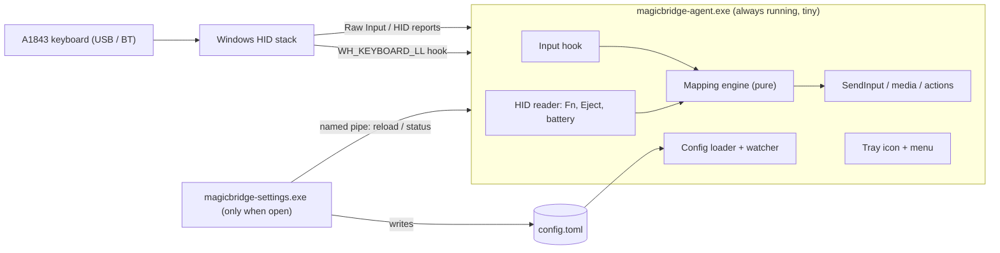

# 03 — Architecture

> Status: **APPROVED (M0 spike resolved)**. See [hardware-findings.md](hardware-findings.md) for hardware ground truth.

## Tech stack (decided — see [decisions/0001-rust.md](decisions/0001-rust.md))

| Concern | Choice |
|---|---|
| Language | **Rust** (stable, `x86_64-pc-windows-msvc`) |
| Win32 API | `windows` crate (official Microsoft bindings) |
| Settings GUI | `egui` / `eframe` (single native exe, only runs while open) |
| Config format | TOML (`serde` + `toml`) in `%APPDATA%\MagicBridge\config.toml` |
| i18n | Simple key→string TOML files per language (`en.toml`, `it.toml`) |
| Build | Cargo workspace; release profile with `lto = true`, `opt-level = "z"` or `3`, `panic = "abort"`, `strip = true` |

## Process model

Two executables, so the heavy GUI never sits in memory:



### Crates (Cargo workspace)
```
crates/
├── core/       # Pure logic: key model, mapping engine, config schema. No Win32. Unit-tested.
├── agent/      # Background exe: hook, HID, tray, IPC server, autostart.
├── settings/   # GUI exe: egui app, visual keyboard, i18n.
└── hid-probe/  # Milestone 0 diagnostic CLI: dumps raw HID reports from the keyboard.
```
Package names: `magicbridge-core`, `magicbridge-agent`, `magicbridge-settings`, `hid-probe`. The core package
can't be called just `core` because that would clash with Rust's built-in `core` library.
Workspace lints deny `unsafe_op_in_unsafe_fn` and `clippy::undocumented_unsafe_blocks`, so every `unsafe` block
needs a `// SAFETY:` comment. `magicbridge-core` also uses `#![forbid(unsafe_code)]`.

## Key technical design

### Input interception
- **`WH_KEYBOARD_LL`** low-level hook for remapping. It's user-mode with no injection, and it's what most
  remappers use. The hook callback has to be **minimal**: look up a precomputed table, then either pass
  the key through or swallow it and queue output. **No allocation, no I/O, no locks** inside the callback
  (NFR-P3). Windows removes hooks that are too slow, so this matters for correctness too.
- Output is sent with `SendInput`. Injected events are tagged (`dwExtraInfo` marker) so the hook
  ignores its own output and can't loop.
- Media actions use the standard virtual keys (`VK_VOLUME_UP`, `VK_MEDIA_PLAY_PAUSE`, …).
- Custom actions (launching programs, etc.) are handed off to a worker thread, never run in the hook.

### Apple-specific keys (Fn, Eject, battery) — resolved in [hardware-findings.md](hardware-findings.md)
- **Fn & Eject:** On the A1843 (`05AC:026C`), `Apple Fn` (`0x00FF:0x0003`) and `Eject` (`0x000C:0x00B8`) are declared inside Input Report `0x01` of the main `0x0001:0x0006` (Generic Desktop / Keyboard) collection rather than in a separate vendor collection. Windows' `kbdhid.sys` locks `0x0001:0x0006` exclusively and discards non-`0x07` usages in kernel mode before `WH_KEYBOARD_LL` or `WM_INPUT`.
- **Fn key implementation (F1.1, F1.4):** A user-configurable key acts as `Fn` (default: **Right Option / `VK_RMENU`**). The hook tracks `fn_down` directly in `WH_KEYBOARD_LL` (and suppresses the synthetic `AltGr` `LCtrl` `sc=0x21D` injected on ISO/Italian layouts when Right Option is remapped).
- **Battery (F6):** Read via `HidD_GetInputReport(0x90)` on Apple collection `0xFF00:0x0014` (`[0x90, status, pct]`, works even on USB) with fallback to the Windows PnP `PKEY_BLUETOOTH_BATTERY` property on Bluetooth device nodes. Polled every N minutes (F6.3).

### Device filtering — resolved in [hardware-findings.md](hardware-findings.md)
- In Milestone 0 (`target\usb-dump.log`), `WM_INPUT` (`RAWKB`, which carries `hDevice`) always arrived **0.43–1.76 ms after** `WH_KEYBOARD_LL` (`HOOK`), because Windows runs low-level hooks synchronously before queueing `WM_INPUT`. Per-keystroke device filtering inside `WH_KEYBOARD_LL` is therefore not possible without blocking the input thread.
- **Selected approach:** Mappings apply globally while an Apple keyboard (`VID 0x05AC`) is connected (tracked via event-driven device arrival/removal notifications) and turn off automatically when none is connected.
- A kernel filter driver (e.g. Interception) is **explicitly rejected**: it needs admin rights, is risky, and can be flagged by anti-cheat software.

### Config & IPC
- `config.toml` is the single source of truth. The GUI writes it atomically (temp file + rename).
- The agent reloads on a **named pipe** message from the GUI (no file polling), and builds a new
  immutable mapping table that the hook picks up through an atomic pointer swap.
- The named pipe also gives the GUI status info: connected/transport/battery/mode.

### Lifecycle
- Autostart: `HKCU\Software\Microsoft\Windows\CurrentVersion\Run` (no admin).
- Single instance: named mutex.
- Device arrival/removal: `WM_DEVICECHANGE` / `RegisterDeviceNotification`. No polling.
- Sleep/resume: `WM_POWERBROADCAST`, which re-registers the hook and re-opens HID if needed.
- Known limitation: a non-elevated hook doesn't receive input while an **elevated** window is focused
  (UIPI). Document it; optionally offer "run elevated" via Task Scheduler later.

## Game-safety notes
- No code runs inside game processes. The hook lives only in the agent.
- Some anti-cheat systems ignore or flag *injected* input. That's why we have the pause hotkey (F9.1)
  and the optional game mode (F9.2): remapping can get out of the way completely.
