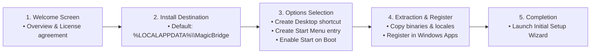
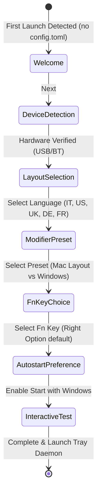
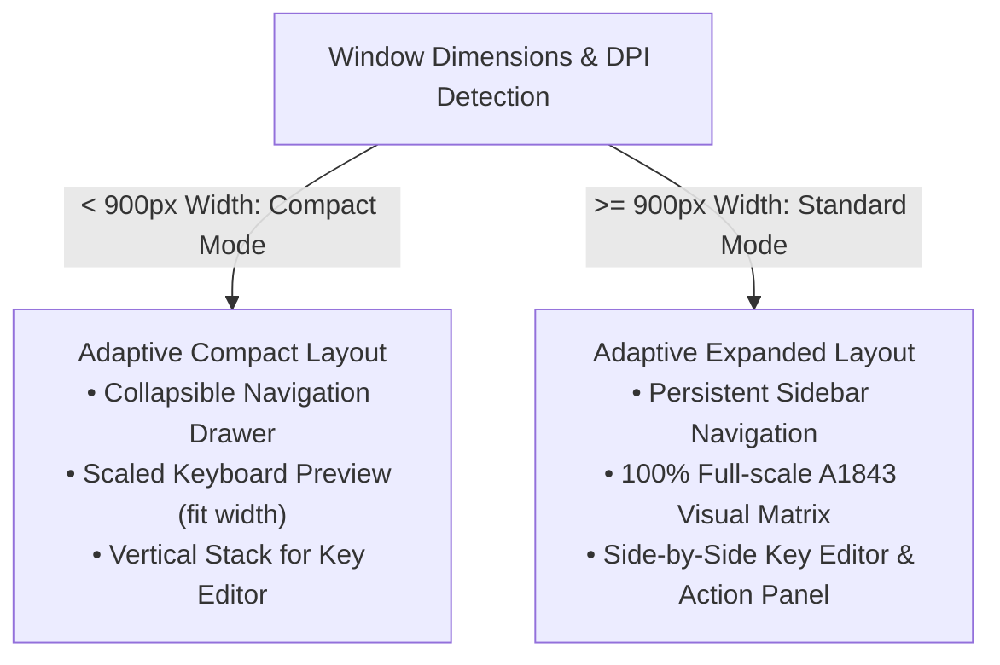

# 07 — UX Improvements & Product Evolution Backlog

This document outlines the design and technical specifications for MagicBridge user experience enhancements, including the **Installation Wizard**, **Initial Configuration Wizard**, **Responsive Settings Layout**, and feature backlog.

---

## 1. Guided Installation Wizard

### Objective:
Replace manual script execution with a seamless, user-friendly guided installation experience suitable for non-technical users.

### Technical Specification:
- **Packaging Target:** Windows standard installer (.exe / .msi) generated via **Inno Setup** or native lightweight Rust installer executable (`magicbridge-setup.exe`).
- **Zero Administrator Elevation Required:** Installs cleanly into `%LOCALAPPDATA%\Programs\MagicBridge` without triggering UAC elevation prompts (satisfies enterprise security and portable operation).
- **Control Panel Integration:** Writes registry entries to `HKCU\Software\Microsoft\Windows\CurrentVersion\Uninstall\MagicBridge` with:
  - DisplayName: "MagicBridge (Apple Magic Keyboard for Windows)"
  - DisplayVersion: "0.2.0"
  - Publisher: "MagicBridge Contributors"
  - UninstallString: `uninstall.exe` or `powershell.exe -ExecutionPolicy Bypass -File uninstall.ps1`
  - DisplayIcon: `magicbridge-agent.exe,0`
- **Clean Uninstallation:** Completely terminates running background agent instances, removes autostart entries from `HKCU\Software\Microsoft\Windows\CurrentVersion\Run`, cleans binary directories, and optionally asks whether to preserve user configuration in `%APPDATA%\MagicBridge`.

---

## 2. Initial Configuration Wizard (First-Run Onboarding)

### Objective:
Guide the user through key customization choices immediately upon first launch so their Apple Magic Keyboard feels natural from second one.

### Step-by-Step Wizard Architecture:
1. **Screen 1: Welcome & Device Auto-Detection**
   - Displays real-time connection status of Apple Magic Keyboard (Model A1843).
   - Shows connection transport: **USB** (`VID 0x05AC`) or **Bluetooth Classic** (`VID 0x004C`) with battery percentage.
2. **Screen 2: Keyboard Physical Layout Picker**
   - Visual preview cards for:
     - `ISO Italian` (Default for Italian users)
     - `ANSI US`
     - `ISO United Kingdom`
     - `ISO German`
     - `ISO French`
3. **Screen 3: Modifier Key Preset**
   - **Mac Style (Default):** Physical `Command` &rarr; `Windows Key`, physical `Option` &rarr; `Alt`.
   - **Windows Standard:** Physical `Command` &rarr; `Ctrl`, physical `Option` &rarr; `Windows Key`.
4. **Screen 4: Fn Layer Trigger Choice**
   - Explains that the physical Apple Fn key is filtered by Windows kernel `kbdhid.sys`.
   - Select fallback trigger key:
     - `Right Option / AltGr` (Recommended default)
     - `Right Control`
     - `Caps Lock`
5. **Screen 5: System Preferences & Autostart**
   - Toggle: "Start MagicBridge automatically when I log into Windows".
   - Toggle: "Top Row keys default to Media controls (Play/Pause, Volume, Brightness)".
6. **Screen 6: Interactive Test Box & Completion**
   - An interactive text area allowing the user to press modifiers and test character output immediately.
   - Saves initial `config.toml` and launches `magicbridge-agent.exe`.

---

## 3. Responsive Layout in Settings GUI (`egui`)

### Objective:
Enable `magicbridge-settings` to adapt dynamically to various screen resolutions, high-DPI scaling factors, and window resizing.

### Technical Design:
1. **Dynamic Keyboard Canvas Scaling:**
   - In `crates/settings/src/views/keyboard_view.rs`: calculate keyboard render dimensions dynamically using `ui.available_width()`.
   - Compute responsive key unit size:
     $$\text{key\_size} = \text{clamp}\left(\frac{\text{ui.available\_width}()}{25.5},\ 24.0,\ 42.0\right)$$
   - Scale key pitch, border rounding, font size, and legends proportionally to ensure crisp rendering on 1080p, 1440p, 4K, and ultra-wide screens.
2. **Adaptive Navigation Rail:**
   - On wide viewports: display persistent left navigation menu with text labels and icons.
   - On narrow viewports (<800px): collapse navigation into an icon rail or top segmented switcher to maximize workspace for key editing.
3. **Fluid Grid for Settings Cards:**
   - Wrap settings cards (General, Battery, Top Row, Architecture) into responsive columns using `egui::Ui::horizontal_wrapped`.

---

## 4. Advanced Improvements Backlog

| Priority | ID | Feature | Description | Target Model Tier |
|---|---|---|---|---|
| **P1** | **IMP-01** | **Guided Installer Wizard** | Self-contained executable wizard for zero-friction installation and uninstallation. | `[T1]` (`flash`) |
| **P1** | **IMP-02** | **Initial Configuration Wizard** | First-run onboarding wizard in `magicbridge-settings` configuring layout, modifiers, and autostart. | `[T2]` (`flash` / `pro`) |
| **P1** | **IMP-03** | **Responsive Settings UI** | Dynamic scaling of visual A1843 keyboard and adaptive navigation across all window sizes. | `[T2]` (`flash` / `pro`) |
| **P2** | **IMP-04** | **Dynamic Tray Battery Badge** | Custom-rendered GDI tray icon displaying battery percentage and charging indicator. | `[T2]` (`flash` / `pro`) |
| **P2** | **IMP-05** | **DDC/CI Monitor Brightness** | Integrate `dxva2.dll` to adjust physical monitor brightness on F1 (Dim) and F2 (Brighten). | `[T3]` (`pro`) |
| **P3** | **IMP-06** | **Per-App Profile Auto-Switching** | Background detection of active foreground process to automatically switch keyboard profiles. | `[T2]` (`flash`) |
| **P3** | **IMP-07** | **GitHub Release Auto-Checker** | Non-intrusive check against GitHub API to notify user when a newer release is published. | `[T1]` (`flash_lite`) |
