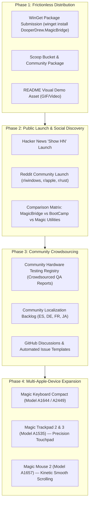
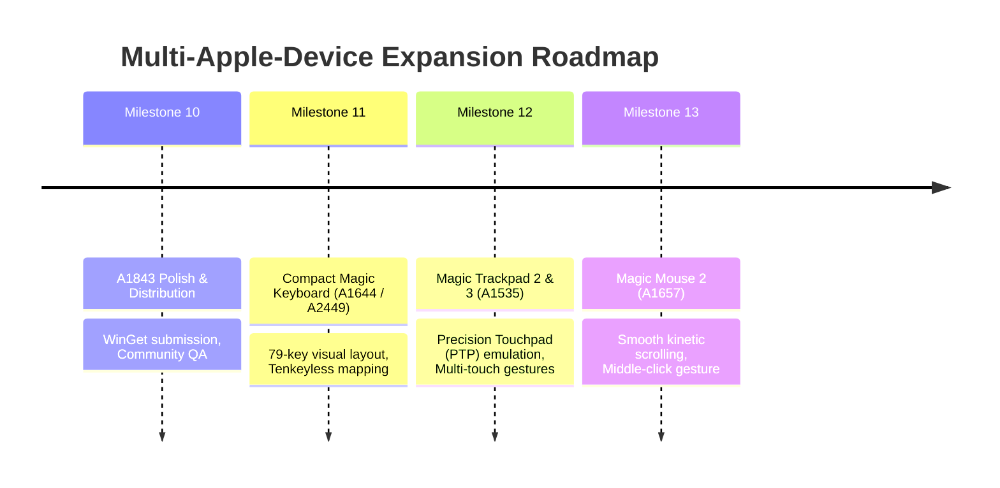

# 08 — Community Growth & Multi-Device Product Roadmap

This document serves as the **strategic master plan and living roadmap** for transforming **MagicBridge** into the premier, community-driven open-source suite for Apple peripherals on Windows.

---

## 1. Vision & Core Philosophy

**Vision:** Enable anyone using Apple hardware on Windows 10/11 to experience seamless, native-level integration without invasive kernel drivers, paid closed-source utilities, or background performance penalties.



---

## 2. Pillar 1: Frictionless Distribution Channels

The easier it is to install MagicBridge, the faster adoption spreads.

### 2.1 Microsoft WinGet Submission (`winget install DooperDrew.MagicBridge`)
- **Status:** Manifests generated in [`packaging/winget/`](../packaging/winget/).
- **How to Submit to Microsoft:**
  1. Fork [`microsoft/winget-pkgs`](https://github.com/microsoft/winget-pkgs).
  2. Copy `packaging/winget/manifests/d/DooperDrew/MagicBridge/0.2.0/` into the upstream repo under `manifests/d/DooperDrew/MagicBridge/0.2.0/`.
  3. Validate locally with Windows Package Manager CLI:
     ```powershell
     winget validate --manifest .\manifests\d\DooperDrew\MagicBridge\0.2.0\
     ```
  4. Submit Pull Request to `microsoft/winget-pkgs`. Once merged by Microsoft's automated pipeline, users worldwide can install with:
     ```powershell
     winget install DooperDrew.MagicBridge
     ```

### 2.2 Scoop Community Manifest
- **Status:** Manifest generated in [`packaging/scoop/magicbridge.json`](../packaging/scoop/magicbridge.json).
- **How to Submit:**
  - Submit `magicbridge.json` to the popular community bucket [`ScoopInstaller/Extras`](https://github.com/ScoopInstaller/Extras).
  - Users install with: `scoop install extras/magicbridge`.

---

## 3. Pillar 2: Social Discovery & Public Launch Playbook

### 3.1 The "Show HN" (Hacker News) Launch
- **Best Day / Time:** Tuesday or Wednesday, 07:00–08:30 AM PT (15:00–16:30 CET).
- **Title Suggestion:**
  > *Show HN: MagicBridge – An invisible, zero-idle-CPU Windows utility for Apple Magic Keyboards (Rust)*
- **Core Talking Points for Developers:**
  1. **Engineering Quality:** Pure Rust, `#![forbid(unsafe_code)]` in core, explicit safety invariants in Win32 wrappers.
  2. **Performance:** Zero-allocation `WH_KEYBOARD_LL` hook callback with latency benchmarked at **< 600 ns** (well within the 100 µs budget).
  3. **Zero Polling / 0% Idle CPU:** Purely event-driven Win32 message loop (`WM_DEVICECHANGE`, `WM_POWERBROADCAST`, `SetWinEventHook`).
  4. **Hardware Reverse Engineering:** Apple Vendor Collection `0xFF00:0x0014` report `0x90` battery telemetry decoding over both Lightning USB and Bluetooth Classic.
  5. **Free & Open Source:** Non-commercial, anti-cheat safe (no kernel drivers, no DLL injection), MIT licensed.

### 3.2 Reddit Community Outreach
- **Subreddits to Target:**
  - `r/windows` and `r/windows11` (Focus: Clean user-mode utility that fixes Apple keyboards on PC).
  - `r/apple` and `r/mac` (Focus: Perfect companion when using your Mac keyboard at a Windows work PC or gaming rig).
  - `r/rust` (Focus: Architecture breakdown, Win32 bindings, egui GUI, multi-agent development workflow).
  - `r/pcmasterrace` (Focus: Free alternative to paid driver packages).
- **Asset Requirement:** A crisp 15-second screen recording showing:
  - Guided setup wizard launch.
  - Pressing `Option` and `Cmd` switching between Mac and Windows layout.
  - Live battery percentage in system tray.
  - The **🧪 Hardware QA** matrix lighting up green on keypresses.

### 3.3 Competitive Value Proposition
Highlight why MagicBridge solves the problem better than alternatives:

| Solution | Anti-Cheat Safe? | Price | CPU Overhead | Battery Telemetry | Open Source? |
|---|---|---|---|---|---|
| **MagicBridge** | **Yes (User Mode)** | **Free (MIT)** | **0% Idle CPU** | **Direct HID (USB & BT)** | **Yes (Rust)** |
| *Apple Boot Camp Drivers* | Warning (Kernel `.sys`) | Free (Manual extract) | High (Idle polling) | No | No (Proprietary) |
| *Magic Utilities* | Warning (Kernel driver) | Paid Subscription | Low | Yes | No (Closed) |
| *PowerToys / AutoHotkey* | Yes (User Mode) | Free | Variable | No battery support | Yes (Heavy scripts) |

---

## 4. Pillar 3: Community Engagement & Crowdsourcing

### 4.1 Community Hardware QA Registry
Encourage users to test their Apple keyboard variants and share their reports:
1. Users open the **🧪 Hardware QA** tab in `magicbridge-settings`.
2. Tap through the keys to verify recognition.
3. Click **"Export QA Log"** and submit the report to a pinned GitHub Discussion or Issue.
4. Maintain a community verified hardware compatibility table:
   - Apple Magic Keyboard with Numeric Keypad (A1843) — Space Gray / Silver.
   - Apple Magic Keyboard with Touch ID and Numeric Keypad (A2520).
   - Apple Magic Keyboard Compact (A1644).

### 4.2 "Good First Issue" Backlog (Crowdsourced Translations)
Create targeted GitHub Issues to attract international contributors:
- `i18n: Add Spanish translation (es.toml)`
- `i18n: Add French translation (fr.toml)`
- `i18n: Add German translation (de.toml)`
- `i18n: Add Japanese translation (ja.toml)`

### 4.3 GitHub Community Health Files
- [x] `README.md` with visual architecture schemes.
- [x] `CONTRIBUTING.md` with coding and testing guidelines.
- [x] `LICENSE` (MIT).
- [ ] Issue Templates (`.github/ISSUE_TEMPLATE/`):
  - Bug report template with hardware connection type (USB vs BT).
  - Hardware QA submission template.
  - Feature request template.

---

## 5. Pillar 4: Multi-Apple-Device Roadmap (The Apple Suite for Windows)

Once the A1843 keyboard reaches v1.0, MagicBridge can gradually expand into a comprehensive utility for all Apple peripherals on Windows:



### 5.1 Device 1: Compact Apple Magic Keyboard (Models A1644 & A2449)
- **Feasibility:** Very High (re-uses 90% of existing `magicbridge-core` and `magicbridge-agent` code).
- **Work Required:** Add a 79-key visual model in `keyboard_model.rs` without numeric keypad and add PID detection for `0x0267` / `0x029C`.

### 5.2 Device 2: Apple Magic Trackpad 2 & 3 (Model A1535)
- **Problem on Windows:** Default inbox driver provides bare minimum pointer movement; multi-touch gestures (3-finger tab switch, pinch-to-zoom, fluid 2-finger scroll) are absent.
- **Solution:** Emulate a Windows Precision Touchpad (PTP) device via user-mode Raw Input or synthetic touch injection, mapping Apple multitouch raw contact reports to Windows touch gestures.

### 5.3 Device 3: Apple Magic Mouse 2 (Model A1657)
- **Problem on Windows:** Mouse wheel scrolling is choppy and stepped, and there is no middle click.
- **Solution:** Decode capacitive touch surface swipe velocity to generate high-resolution smooth kinetic scrolling events and recognize two-finger taps as middle-click.

---

## 6. Living Execution Checklist (Status Tracker)

Use this checklist to track community and product milestones over time:

### Distribution & Launch (Phase 1 & 2)
- [x] Package manifests generated for WinGet (`packaging/winget/`) and Scoop (`packaging/scoop/`).
- [x] Release packaging automation (`scripts/generate-manifests.ps1` and `package-release.ps1`).
- [ ] Submit PR to `microsoft/winget-pkgs` for `DooperDrew.MagicBridge`.
- [ ] Record a 15-second demonstration GIF showing setup wizard, live battery, and QA key tester for `README.md`.
- [ ] Post "Show HN" on Hacker News.
- [ ] Post showcases on `r/windows11`, `r/apple`, and `r/rust`.

### Community Engagement (Phase 3)
- [ ] Enable GitHub Discussions in repository settings.
- [ ] Add GitHub Issue templates (`.github/ISSUE_TEMPLATE/` for Bug Reports and Hardware QA Submissions).
- [ ] Open `good first issue` tickets for community translations (Spanish, French, German, Japanese).
- [ ] Gather 5+ physical hardware QA verification logs from community members for the Hardware Registry.

### Product Evolution (Phase 4)
- [ ] M10.4: Dynamic battery tray icon badge with live percentage rendering via GDI.
- [ ] Add support for Compact Magic Keyboard (Model A1644 / A2449).
- [ ] Research user-mode Precision Touchpad emulation for Apple Magic Trackpad (Model A1535).
