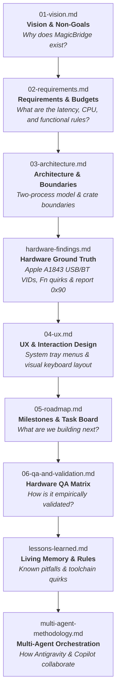

# MagicBridge Documentation System

This directory contains the canonical specifications, hardware findings, architectural blueprints, and living governance logs for **MagicBridge**.

In an agent-assisted and autonomous engineering environment, **the codebase specifications are the primary interface between human intent and AI execution**. Keeping technical truth in version-controlled markdown files prevents context drift, hallucinated constraints, architectural fragmentation, and abandoned conventions.

---

## 📚 Specification Hierarchy & Reading Order

Whenever an agent or human developer enters the repository, documents must be consulted in this exact sequence before any code is generated or modified:

---

## 🗂️ Document Inventory

| File | Purpose | Key Content & Conventions |
|---|---|---|
| [`01-vision.md`](01-vision.md) | **North Star** | Core problem statement, non-goals, guiding principles, and target Apple Magic Keyboard Model A1843 identity. |
| [`02-requirements.md`](02-requirements.md) | **Functional & NFR Specs** | MoSCoW-prioritized features (`F1`–`F7`), strict quantitative budgets (`NFR-P1`..`P5`: <0.1ms latency, 0% idle CPU, <5MB RAM), and anti-cheat safety (`NFR-S1`). |
| [`03-architecture.md`](03-architecture.md) | **Structural Blueprint** | Two-process model (`magicbridge-agent` + `magicbridge-settings`), crate separation, IPC protocol, and hook event lifecycle. |
| [`04-ux.md`](04-ux.md) | **Tray & UI Specifications** | System tray interaction, notification policies, and `egui` visual keyboard design. |
| [`05-roadmap.md`](05-roadmap.md) | **Single Source of Truth for Tasks** | Phased milestones (M0 through M11). Parallel tasks marked with `⇉`. Checked off with date and git commit upon verification. |
| [`06-qa-and-validation.md`](06-qa-and-validation.md) | **Empirical Proof & Test Matrices** | Apple A1843 physical hardware matrix (`QA-HW-01`..`12`), edge-case power state tests, and NFR latency benchmark logs. |
| [`07-ux-and-improvements.md`](07-ux-and-improvements.md) | **User Experience & Onboarding** | Installer wizard, first-run onboarding configuration wizard, responsive GUI layouts, and battery tray badges. |
| [`08-community-and-growth-strategy.md`](08-community-and-growth-strategy.md) | **Ecosystem & Community** | WinGet/Scoop distribution channels, launch playbooks (Hacker News, Reddit), and multi-device expansion roadmap (A1644, A1535, A1657). |
| [`hardware-findings.md`](hardware-findings.md) | **Hardware Ground Truth** | Verified Apple A1843 hardware discoveries: USB VID `0x05AC` vs BT VID `0x004C`, kernel Fn stripping, Italian AltGr `0x21D` scancode quirk, and battery report ID `0x90`. |
| [`lessons-learned.md`](lessons-learned.md) | **Living Memory & Rules Engine** | Feedback log turning developer corrections and toolchain debugging insights into enforceable engineering rules. |
| [`retrospective.md`](retrospective.md) | **Project Retrospective** | Comprehensive retrospective mining git history and 19 agent conversations across M0–v0.2.0. |
| [`multi-agent-methodology.md`](multi-agent-methodology.md) | **Multi-Agent Orchestration** | Hub-and-Spoke Lead/Worker model, Sole Committer Protocol, complexity tiers, GitHub Copilot cloud agent integration, and Draft PR workflows. |
| [`model-fallback-log.md`](model-fallback-log.md) | **Model Routing & Quota Audit** | Audit log tracking tasks run on fallback or lower-tier models. |
| [`release-methodology.md`](release-methodology.md) | **Release Engineering** | SemVer definitions, single source of version truth, release checklist, tagging procedure, and GitHub release automation. |
| [`user-guide.md`](user-guide.md) | **End-User Documentation** | Complete user manual covering multi-channel installation (WinGet, Scoop, Setup Wizard, Portable ZIP), Fn lock, modifier presets, custom actions, and troubleshooting. |
| [`decisions/`](decisions/) | **Architecture Decision Records (ADR)** | Lightweight records capturing context, options considered, and architectural rationale. |

---

## 🔬 Core Working Agreements

1. **Claims Follow Evidence:** Never mark physical hardware tests as passed without empirical evidence captured from testing on an Apple Magic Keyboard Model A1843. Automated invariant tests are marked `PASS`; physical rows in `06-qa-and-validation.md` remain marked **`[Pending Physical Confirmation]`**.
2. **Knowledge Lives in the Repo, Not in Chats:** Any architectural decision, lesson learned, or hardware finding that should outlive the conversation session must be written to a file in `docs/` or `CHANGELOG.md` before the turn ends.
3. **Sole Committer Protocol:** Only the Lead Orchestrator agent interacting with the user may execute `git commit`, `git push`, edit remotes, or close GitHub issues. Worker subagents and cloud agents operate strictly on branches or draft pull requests.
