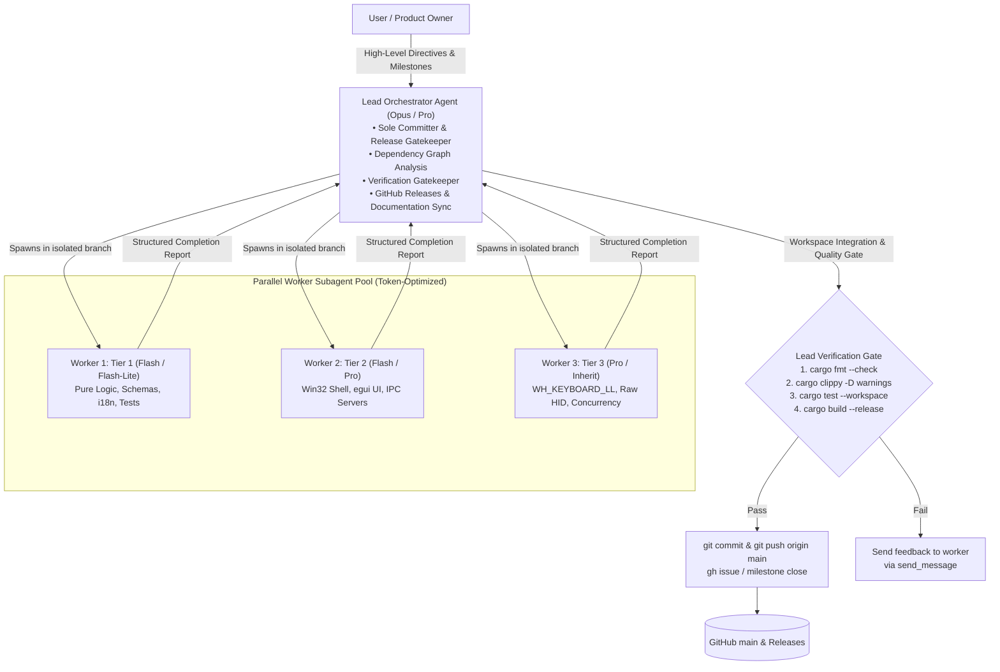
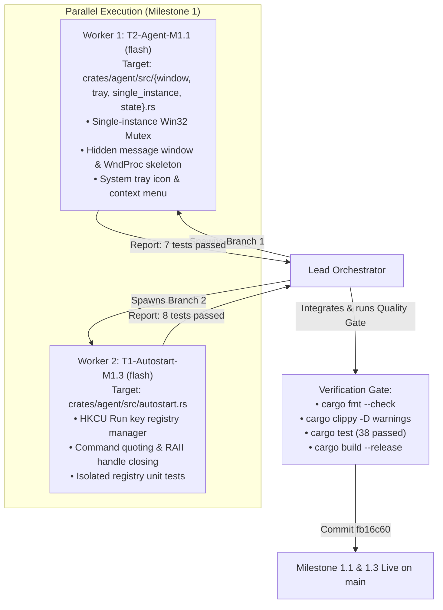
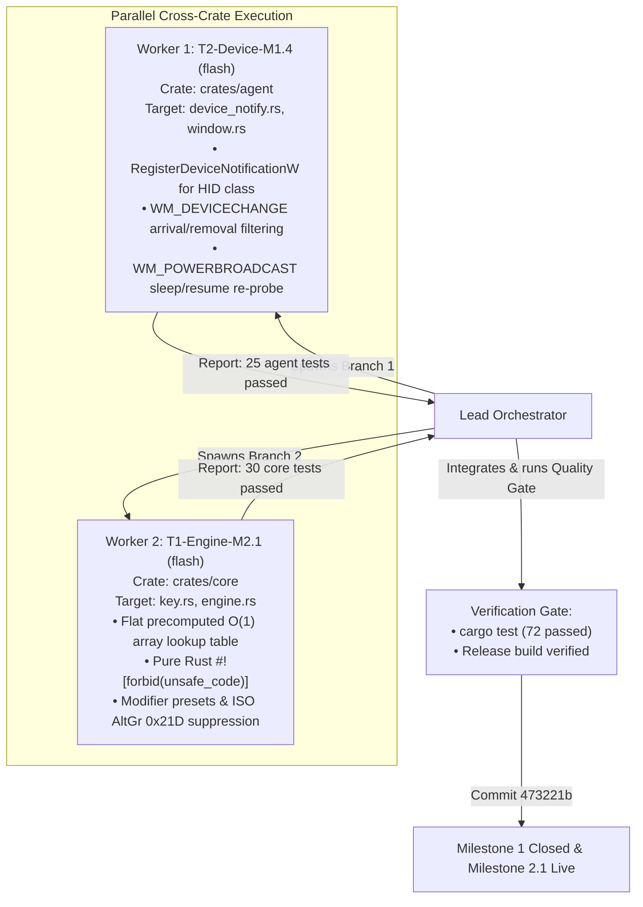
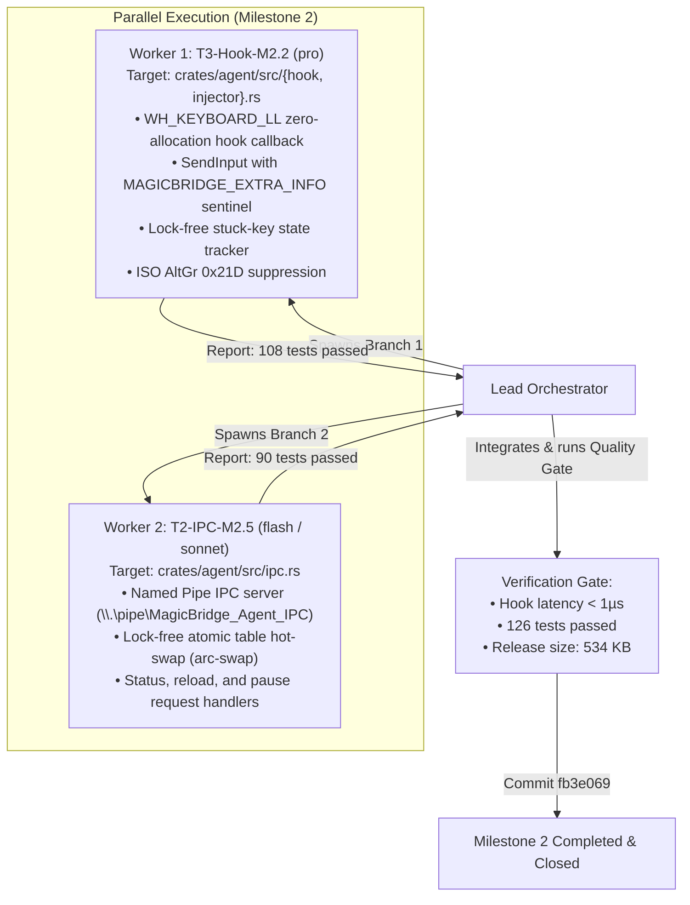
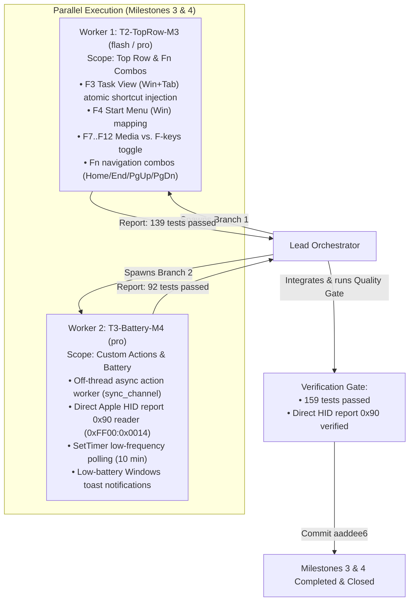
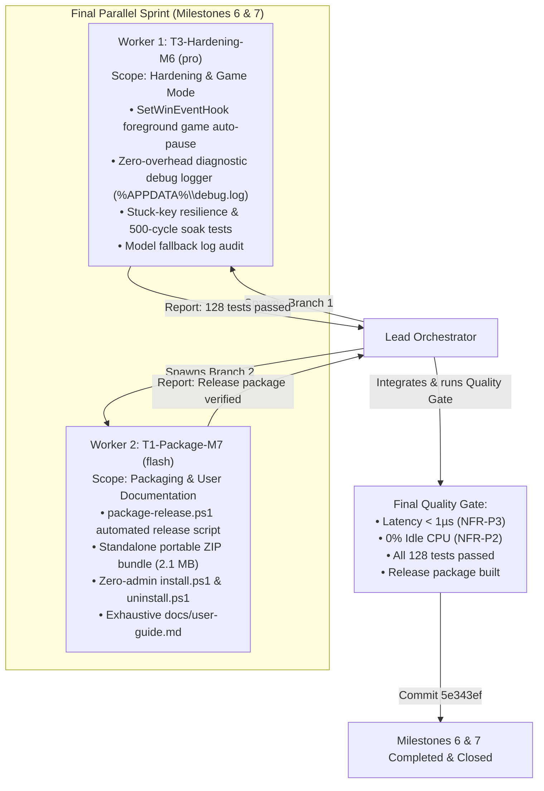
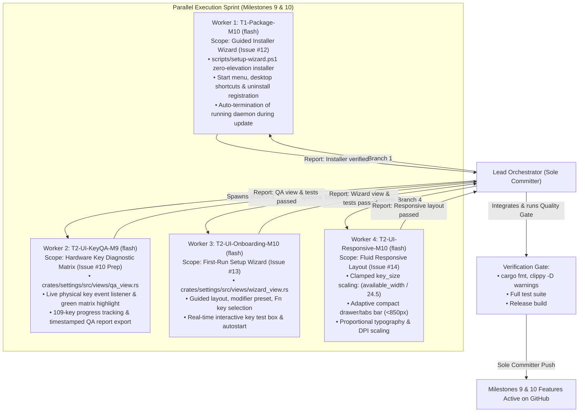
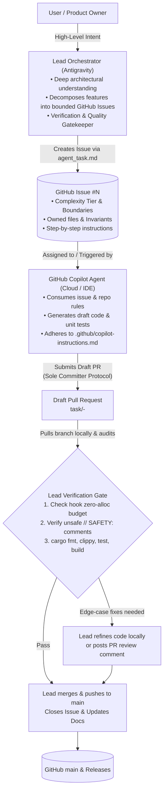
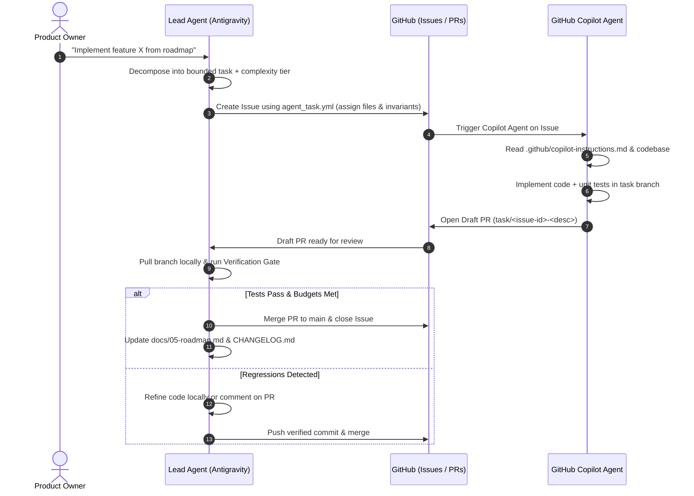

# Multi-Agent Parallel Architecture & Methodology Guide

> **Audience:** AI Engineers, System Architects, Open-Source Contributors, and Autonomous Agents.  
> **Status:** Canonical Living Document (Milestone 8).  
> **Repository:** [`https://github.com/DooperDrew/magicbridge`](https://github.com/DooperDrew/magicbridge)

---

## 1. Executive Summary & Philosophy

When building native systems utilities with stringent non-functional constraints (such as zero idle CPU, sub-microsecond hook latency, and anti-cheat compliance), software development often suffers from two bottlenecks:
1. **Context Window Exhaustion & Cognitive Overload:** A single agent or conversational session attempting to hold the entire Win32 API, raw HID specifications, UI rendering loops, and build scripts quickly hits context saturation, resulting in hallucinated APIs or subtle regressions.
2. **Sequential Development Latency & Token Waste:** Running simple boilerplate generation or documentation tasks on high-reasoning flagship models (e.g., Claude 3.7 Sonnet or Gemini 1.5 Pro) burns unnecessary token budgets, while running low-level kernel/hook synchronization on smaller models leads to memory safety bugs.

**MagicBridge** demonstrates a pioneering, production-grade **Hub-and-Spoke (Lead Orchestrator & Parallel Worker)** methodology. By decomposing tasks into **strictly isolated, dependency-free work packages** and orchestrating multi-tiered AI models running in parallel git worktree branches, the entire project was built and validated with **zero git merge conflicts, 134 automated unit/integration tests passing (100%), and headless stuck-key invariant validation** (with physical hardware matrix validation pending user confirmation).



---

## 2. Dynamic Model Selection & Complexity Tiers

To maximize token efficiency without sacrificing code safety, tasks are categorized into three distinct complexity tiers:

| Tier | Workload Scope | Architectural Criteria | Target Model | Token Cost Optimization |
|---|---|---|---|---|
| **Tier 1 (T1 — Lean)** | Pure business logic, data schemas, serialization, unit tests, i18n dictionaries, packaging scripts, docs. | • Pure Rust (`crates/core`).<br>• Strictly `#![forbid(unsafe_code)]`.<br>• Zero Win32 dependencies. | **`flash`** or **`flash_lite`** | **~80–90% reduction** in token expenditure. Fast execution. |
| **Tier 2 (T2 — Moderate)** | UI widgets, event handling, named pipes, standard Win32 message pumps. | • `egui` views & layout widgets.<br>• Tray menus & callbacks.<br>• Named pipe client/server requests. | **`flash`** or **`pro`** (task-dependent) | Balanced reasoning and throughput. |
| **Tier 3 (T3 — Complex / Critical)** | Low-level input hooks, atomic memory swaps, raw HID battery reporting, multi-threaded timing synchronization. | • `WH_KEYBOARD_LL` callback.<br>• Budget compliance (<0.1ms latency, zero alloc/locks).<br>• Hardware timing quirks (`sc=0x21D`). | **`pro`** or **`inherit`** (Opus / Sonnet) | Deepest reasoning, absolute safety. |

### Fallback & Retrospective Audit Loop
If rate limits or quota exhaustion make a higher-tier model temporarily unavailable:
1. **Deterministic Fallback:** `inherit` &rarr; `pro` &rarr; `flash` &rarr; `flash_lite`.
2. **Audit Logging:** The Lead Agent logs the event into [`model-fallback-log.md`](model-fallback-log.md).
3. **Scheduled Review:** Task **M6.5** in Milestone 6 performs an automated audit using a flagship model once tokens are restored.

---

## 3. The Sole Committer Protocol & Workspace Isolation

In a multi-agent environment, having multiple agents write directly to the same branch or execute `git commit` concurrently causes index locks, detached heads, and corrupted merge trees.

### Roles and Guardrails:
1. **The Lead Orchestrator Agent (Sole Committer):**
   - The **ONLY** entity authorized to run `git commit`, `git push`, edit git remotes, modify `origin main`, create GitHub Releases, or close GitHub Issues.
   - Analyzes tasks for dependency orthogonalities.
   - Executes the final integration verification gate on the combined code.
2. **Worker Agents (`magicbridge-worker`):**
   - Work strictly in isolated git worktrees created via `Workspace: "branch"`.
   - **Hardcoded prohibition:** Forbidden from running `git commit`, `git push`, `git checkout main`, or `gh issue close`.
   - Deliver changes via structured completion reports.

---

## 4. Phase-by-Phase Parallelization Blueprint

Below are the architectural dependency schemes and execution timelines used throughout the MagicBridge development lifecycle:

### Phase 1: Milestone 1 Parallelization (Skeleton & Autostart)



**Why this succeeded:** `autostart.rs` was an isolated module with zero dependencies on the window message pump. Both workers wrote to completely distinct files.

---

### Phase 2: Cross-Crate Parallelization (Milestones 1.4 & 2.1)



**Why this succeeded:** Clean crate boundary separation! Worker 1 worked exclusively in `crates/agent` while Worker 2 worked exclusively in pure `crates/core`. Zero merge friction.

---

### Phase 3: Milestone 2 Parallelization (Hook Engine & Named Pipe IPC)



---

### Phase 4: Milestones 3 & 4 Parallelization (Top Row Modes & Battery Telemetry)



---

### Phase 5: Milestones 6 & 7 Parallelization (Hardening & Packaging)



---

### Phase 6: Milestones 9 & 10 Parallelization (UX Onboarding, Hardware QA & Responsive Layout)

In Phase 6, 4 autonomous worker subagents were spawned simultaneously across isolated branch workspaces to accelerate user onboarding, responsive design, and hardware QA preparation:



**Why this succeeded:** Clear orthogonal task definitions! Worker 1 owned installer scripting, Worker 2 owned `qa_view.rs`, Worker 3 owned `wizard_view.rs`, and Worker 4 owned layout scaling in `keyboard_view.rs` and `app.rs`.

---

## 5. Standardized Subagent Taxonomy & Reporting Contract

Every subagent follows a strict naming taxonomy and returns a machine-parsable completion report:

### Role Naming Convention
`<Tier>-<Domain>-<Milestone>`
- `T1-Core-M1`: Pure logic, config schema, unit tests (`flash`).
- `T3-Hook-M2`: `WH_KEYBOARD_LL` low-level input hook and timing (`pro`).
- `T2-UI-M5`: `egui` visual keyboard and profile views (`flash` / `pro`).
- `T1-Package-M7`: Release packaging scripts and documentation (`flash`).

### Worker Completion Report Template
```markdown
### WORKER COMPLETION REPORT: <Role>
- Task: <Milestone ID and Description>
- Model Used: <Model identifier>
- Files Modified / Created:
  - <path to file 1>
  - <path to file 2>
- Verification Status:
  - cargo fmt --all -- --check: <PASS/FAIL>
  - cargo clippy --workspace --all-targets -- -D warnings: <PASS/FAIL>
  - cargo test --workspace: <Count passed, 0 failed>
  - cargo build --workspace --release: <PASS/FAIL>
- Summary of Changes & Technical Decisions:
  1. <Architectural decision 1>
  2. <Architectural decision 2>
  3. <Safety rationale>
```

---

## 6. How to Extend This Workflow for Future Developments

This methodology is designed to scale indefinitely as new features are added:

### Step 1: Orthogonality & Dependency Analysis
Before spawning workers, identify which files and crates can be worked on concurrently without conflicting edits:
- *Rule of Thumb:* Separate files within the same crate can be parallelized if they do not share function signatures under active modification.
- *Best Pattern:* Cross-crate parallelization (e.g., `crates/core` vs. `crates/agent` vs. `crates/settings`).

### Step 2: Assign Complexity Tiers & Spawn
Use `invoke_subagent` specifying the appropriate tier model:
- `flash` for boilerplate, schema definitions, unit tests, and documentation.
- `pro` or `inherit` for hooks, concurrency, low-level OS drivers, and complex UX event flows.

### Step 3: Run the Verification Gate & Commit
Once worker completion reports are received:
```powershell
$env:Path = [Environment]::GetEnvironmentVariable('Path','Machine') + ';' + [Environment]::GetEnvironmentVariable('Path','User') + ";$env:USERPROFILE\.cargo\bin"
cargo fmt --all -- --check
cargo clippy --workspace --all-targets -- -D warnings
cargo test --workspace -- --test-threads=1
cargo build --workspace --release
```
Only the Lead Agent stages, commits, tags, and pushes to `origin main`.

---

## 7. Cloud Multi-Agent Collaboration: GitHub Copilot Agent Integration

While Antigravity subagents provide ultra-low-latency local branch parallelization, MagicBridge also supports cloud-native asynchronous execution via **GitHub Copilot Agent** using a strict division of labor:





### Division of Roles:
| Role | **Lead Agent (Antigravity)** | **GitHub Copilot (Agent & IDE)** |
|---|---|---|
| **Primary Job** | **Architect & Quality Gatekeeper** | **Fast Draft Implementer** |
| **Responsibilities** | • Maintains architectural integrity & docs.<br>• Breaks features into modular GitHub Issues.<br>• Runs final verification gate.<br>• Sole committer to `origin main`. | • Consumes the issue & drafts code in the cloud.<br>• Generates boilerplate & unit tests.<br>• Speeds up inline edits & commit messages in IDE. |
| **Interaction** | User interacts with Lead when planning or reviewing finished milestones. | Runs autonomously in the background on GitHub. |

### Configuration Guardrails:
1. **`.github/copilot-instructions.md`:** Permanent repository memory for Copilot. Enforces hook thread zero-allocation rules (`NFR-P3`), pure logic `#![forbid(unsafe_code)]`, and the Sole Committer Protocol.
2. **`.github/ISSUE_TEMPLATE/agent_task.md` / `agent_task.yml`:** Standardized task schema providing context, file ownership boundaries, and verifiable acceptance criteria.
3. **Draft PR Pattern:** Copilot never touches `main` directly. All changes arrive as Draft PRs for local lead auditing and verification before merge.
