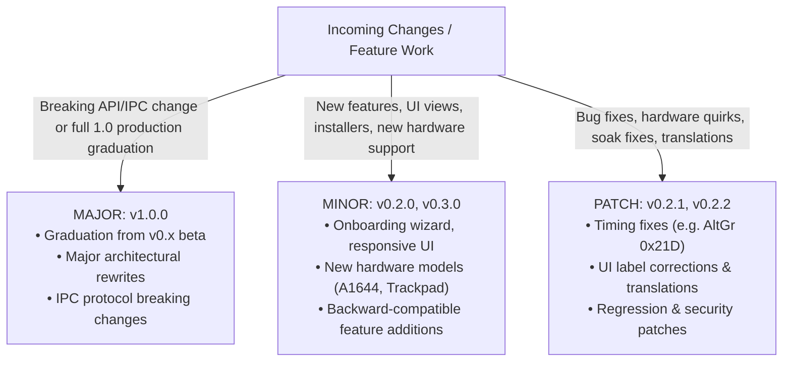
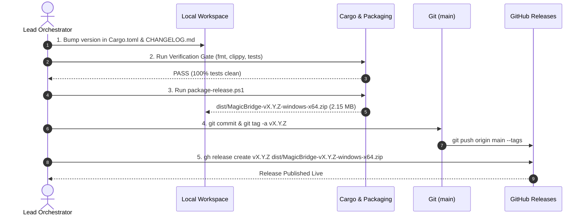

# Release & Versioning Methodology

This document establishes the official release methodology, semantic versioning guidelines, packaging workflows, and release gate checklist for **MagicBridge**.

---

## 1. Semantic Versioning Specification (SemVer)

MagicBridge adheres strictly to [Semantic Versioning 2.0.0](https://semver.org/):

$$\text{Version} = \text{MAJOR}.\text{MINOR}.\text{PATCH}$$



| Component | Increment Trigger | Examples in MagicBridge |
|---|---|---|
| **MAJOR** (`X.0.0`) | Breaking architecture shifts, IPC protocol breaks, or official graduation to production v1.0. | `v1.0.0`: First public general availability release with physical hardware signoff. |
| **MINOR** (`0.X.0`) | New backward-compatible features, major UX additions, installers, new keyboard models. | `v0.2.0`: Setup wizard, onboarding flow, responsive layout, 109-key QA tester. |
| **PATCH** (`0.X.Y`) | Bug fixes, hardware scancode quirk additions, localization updates, performance tuning. | `v0.2.1`: Bluetooth timing adjustment, Italian translation fix. |

---

## 2. Single Source of Truth (SSOT)

All project versions derive exclusively from the workspace root [`Cargo.toml`](../Cargo.toml):

```toml
[workspace.package]
version = "0.2.0"
```

All 4 member crates (`magicbridge-core`, `magicbridge-agent`, `magicbridge-settings`, `hid-probe`) inherit this version automatically via `version.workspace = true`.

Packaging scripts ([`scripts/package-release.ps1`](../scripts/package-release.ps1) and [`scripts/setup-wizard.ps1`](../scripts/setup-wizard.ps1)) dynamically parse this version string at build time.

---

## 3. The 5-Step Official Release Procedure

Every official release MUST follow this protocol executed by the **Lead Orchestrator (Sole Committer)**:



### Step 1: Version Bump & Changelog Preparation
1. Update `version = "X.Y.Z"` in root `Cargo.toml`.
2. Add a comprehensive entry in [`CHANGELOG.md`](../CHANGELOG.md) under `## YYYY-MM-DD — MagicBridge vX.Y.Z: <Release Title> (Release ✅)`.
3. Update version badge in [`README.md`](../README.md) and [`docs/05-roadmap.md`](05-roadmap.md).

### Step 2: Quality Verification Gate
Run and ensure zero errors or warnings:
```powershell
# Format check
cargo fmt --all -- --check

# Strict linter
cargo clippy --workspace --all-targets -- -D warnings

# Full workspace test suite
cargo test --workspace

# Release profile compilation
cargo build --workspace --release
```

### Step 3: Release Packaging & Distribution Manifests
Run the automated release packaging tool:
```powershell
powershell -ExecutionPolicy Bypass -File .\scripts\package-release.ps1
```
This produces:
1. `dist/MagicBridge-v<version>-windows-x64.zip` containing:
   - `magicbridge-agent.exe`
   - `magicbridge-settings.exe`
   - `locales/` (`en.toml`, `it.toml`)
   - `setup-wizard.ps1` & `setup.cmd`
   - `install.ps1` & `uninstall.ps1`
   - `installer.iss`
   - `user-guide.md`, `README.md`, `LICENSE`
2. **WinGet Manifests:** `packaging/winget/manifests/d/DooperDrew/MagicBridge/<version>/` (version, installer, and defaultLocale YAMLs ready for `microsoft/winget-pkgs`).
3. **Scoop Manifest:** `packaging/scoop/magicbridge.json` (auto-populated with latest SHA256 and release download URL).

### Step 4: Git Commit & Tagging
```powershell
git add Cargo.toml Cargo.lock CHANGELOG.md README.md docs/ scripts/
git commit -m "chore: bump release version to vX.Y.Z"
git tag -a vX.Y.Z -m "MagicBridge vX.Y.Z — <Release Title>"
git push origin main --tags
```

### Step 5: GitHub Release Publication
Publish the release asset and changelog to GitHub:
```powershell
gh release create vX.Y.Z "dist\MagicBridge-vX.Y.Z-windows-x64.zip" --title "MagicBridge vX.Y.Z — <Title>" --notes-file <notes.md>
```

---

## 4. Release Checklist & Rollback Plan

### Pre-Release Gatekeeper Checklist:
- [ ] Working tree is clean (`git status`).
- [ ] Memory footprint verified under budget (< 5 MB RAM idle for daemon, NFR-P1).
- [ ] Latency verified under budget (< 0.1 ms hook lookup, NFR-P3).
- [ ] No hardcoded strings in GUI (100% translation coverage in `en.toml` & `it.toml`).
- [ ] Distribution archive verified to contain executable binaries, translation files, and installer scripts.

### Hotfix / Emergency Rollback Plan:
If a critical hardware bug or regression is discovered in a release:
1. Immediately issue a hotfix patch (e.g. `v0.2.1`).
2. Mark the defective release as pre-release or add a warning note on GitHub Releases using `gh release edit vX.Y.Z --notes "..."`.
3. Push the patch through the same 5-step release pipeline.
